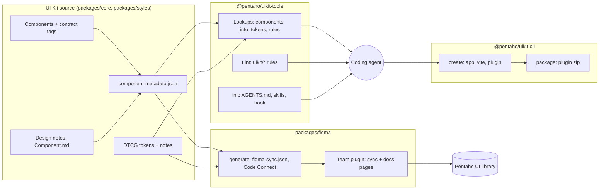

# Agent tooling for the HV UI Kit

How coding agents and designers build Pentaho UI from the UI Kit itself: what exists, how each part works, and how the
parts compose from a plain request to a packaged Pentaho plugin.

**Status.** Everything here works in this repository and is covered by tests, end-to-end checks and agent evals. None
of it is in production: `@pentaho/uikit-tools` and this version of `@pentaho/uikit-cli` are held from release
(`private`), plugins run on sample data and haven't been installed on a Pentaho server, and the Figma sync was proven on
a branch of the Pentaho UI library (its main file untouched).

## The principle

The UI Kit is the single source of truth. Agents and the Figma library don't get a copy of the design system; they read
it from the UI Kit version a project installs, so when the UI Kit changes, what they build with changes with it.

- **Code owns** components, their contracts and props, the tokens, and the design guidance (notes and rules).
- **Agents look things up** before writing, through one CLI that is also an MCP server, and their output is checked by
  the same design rules, as lint.
- **Figma is generated** from code (variables, text styles, documentation pages, Code Connect). A designer's edit in
  Figma is kept and reported as a proposal for code, never overwritten.
- **People review.** Every run hands over screenshots of every state and a plain note of what the agent assumed.



## What exists

| Path                                         | Package                     | Published      | What it is                                                                                     |
| -------------------------------------------- | --------------------------- | -------------- | ---------------------------------------------------------------------------------------------- |
| `packages/core/src/**/<Component>.md`        | `@pentaho/uikit-react-core` | next release   | Design notes: when to use, what the consumer provides, spec, don'ts                            |
| `packages/core/scripts/extract-contracts.js` | (build step)                | output ships   | Merges contract tags, notes and TS props into `dist/component-metadata.json`                   |
| `packages/core/src/utils/componentColors.ts` | (internal)                  | no             | Component colors that aren't theme tokens (Avatar, input fill), read by styles and Figma sync  |
| `packages/styles` tokens                     | `@pentaho/uikit-styles`     | next release   | DTCG tokens (`tokens/*.tokens.json`) with notes on what each token is for                      |
| `packages/tools`                             | `@pentaho/uikit-tools`      | held (private) | Lookups, MCP server, lint plugin, `init`, rules and agent skills                               |
| `packages/cli`                               | `@pentaho/uikit-cli`        | 7.0.x, older   | `create`, `package` and `shots`; this TypeScript version is held (private)                     |
| `templates/{app,vite,plugin}`                | (copied by the CLI)         | inside the CLI | Project templates, each with `AGENTS.md`                                                       |
| `packages/config`                            | `@pentaho/uikit-config`     | yes            | Shared TypeScript and Prettier config the templates extend                                     |
| `packages/figma`                             | `@pentaho/uikit-figma`      | private        | Figma sync, documentation pages, Code Connect, compare and capture                             |
| `packages/cli/evals`                         | (repo only)                 | no             | A/B evals: an agent on a task with and without the tooling                                     |
| `skills/uikit-design`                        | (repo skill)                | no             | Design guidance skill; no agent loads it yet (move it into packages/tools/skills or retire it) |

## How each capability works

### 1. Design context from code

Each component carries contract JSDoc tags (`@variantSemantics`, `@stateRules`, `@a11y`; see
`.github/instructions/component-contracts.instructions.md`) and a design note beside it. The core build runs
`extract-contracts.js`, which merges both with the TypeScript props into `dist/component-metadata.json` and fails on a
note that breaks the expected sections. Tokens come from `@pentaho/uikit-styles` as DTCG JSON, each with a note on its
use (`tokens.notes.json`). Rules live in `packages/tools/templates/rules/*.md`, one section per rule id
(`tokens/colors`, `components/data-states`), and notes cite lint rules by id; a test fails on a citation that doesn't
exist.

### 2. Lookups and the MCP server (`@pentaho/uikit-tools`)

`uikit-tools components | info <Component>… | tokens [words] | rules | rule <id>` read the installed core's metadata and
the installed styles' tokens, so answers match the UI Kit version in `node_modules`. `info` takes several components at
once (`dialog` or `HvDialog`), suggests close names, spells out a named type's values and resolves hooks to their
declaration; `--spec` adds the designers' spec.
`uikit-tools mcp` serves the same text as MCP tools: `list_components`, `get_component`, `list_rules`, `get_rule`,
`find_tokens` and `lint`, for agents that prefer tools to commands (`init --mcp`).

### 3. Design rules as lint

The `uikit/*` plugin runs under oxlint (`@pentaho/uikit-tools/oxlint.json`) and ESLint (`@pentaho/uikit-tools/lint`).
Its rules (`uikit-tools rules`) catch raw elements where a component exists, inline styles, hardcoded values, sizes
off the theme, deprecated props (read per file from the installed core's types), controls without accessible names
and internal imports. `uikit-tools lint` runs them with the oxlint the package ships, so it works in any project.

### 4. Agent setup (`uikit-tools init`)

`init` writes a short `AGENTS.md` block that points agents at the lookups (Claude Code and Gemini also import the
rules into every session) and, in a plugin, the plugin skills where each agent loads them: `.claude/skills` for Claude Code,
`.agents/skills` for Codex and Gemini, either for Copilot and Cursor. For Claude Code it also adds a `Stop` hook that
lints the project before the agent finishes and returns the findings once (an after-edit hook missed files written
through the shell). `--mcp` adds each agent's MCP config; `--figma` the Figma skills. Agents: Claude Code, Copilot,
Cursor, Codex and Gemini (`--agents`, default `claude,copilot`). It merges into existing JSON and JSONC configs and is
idempotent; re-run it after a UI Kit upgrade to refresh the skills.

### 5. Skills

Lean, procedural instructions loaded on demand:

| Skill                    | Entry point                    | Output                                                                       |
| ------------------------ | ------------------------------ | ---------------------------------------------------------------------------- |
| `pentaho-plugin`         | A request, or approved screens | A plugin from the template: views, sample data, a test per view, screenshots |
| `pentaho-plugin-package` | A built plugin                 | A checked, zipped plugin and a plain note for the PM                         |
| `pentaho-figma-screens`  | A request                      | Figma frames built from the Pentaho UI library, every value bound            |
| `pentaho-figma-review`   | Figma frames                   | A review against the system: components, tokens, content, states, a11y       |

When an approved design exists, its frames win over the skill's own defaults. Without one, the defaults hold: a toolbar
row above what it acts on, `HvDialog` (not a drawer) for a row's details and edits, `ViewLayout` margins.

### 6. Scaffolding and packaging (`@pentaho/uikit-cli`)

`uikit-cli create <name> -t app|vite|plugin` copies a template, stamps the released versions and the name, and never
prompts when given a name (so agents and CI can run it). Every template starts on one minimal page to replace. The
plugin template has the App Shell frame, `ViewLayout` (with a slot for the view's primary action), sample data with
states (`?samples=empty`, `{"$status": 503}`), `answerFromSamples()` for tests, and `npm run check` (format, lint,
types). `uikit-cli shots` (`npm run shots`) screenshots the running views listed in `review/shots.json`;
`uikit-cli package` builds, checks and zips a plugin for a server's plugin folder.

### 7. Figma from code (`packages/figma`)

- `npm run generate` writes `figma-sync.json` (Primitives, Color in light and dark, Spacing, Radius, Typography, with
  scopes, CSS code syntax and notes; and text styles) and Code Connect templates for the library's components and
  icons, from the tokens, the component metadata and `code-connect/library.json`. CI fails if they're stale
  (`--check`).
- The team's Figma plugin applies the sync and draws each component's documentation page from `content/pages`. It
  marks what it makes and changes only that. Each variable keeps a baseline of what the last sync wrote, so a
  difference is classified: code moved (updated), a designer changed it (kept, reported), or both (conflict, nothing
  written). A first sync adopts the library's own variables, writing the code's notes, scopes and code syntax where
  the values already match. Nothing is deleted.
- `npm run compare` (read-only, REST) reports how far a file is from the code; `capture` refreshes component
  properties. CI never publishes Code Connect: publishing writes to the library, so it is a manual step, agreed with
  the design team.

### 8. Evals (`packages/cli/evals`)

`run.ts <task>` creates the plugin, sets up a condition (`full`: `uikit-tools init`; `bare`: the same template with the
tooling taken out, checked gone), runs Claude Code headless on the request in a container, then the gate (the plugin's
own `check`, `build` and `package`, and its page coming up) and the review screenshots. `grade.ts` has a model judge
the screenshots blind to the condition; `report.ts` compares the arms on acceptable, pass^k and cost. Tasks, on demo
data: `users` (a list with actions), `data-connection` (a settings form) and `report-usage` (a dashboard).

## How they compose

The capabilities are independent and share one source, so any entry point leads to the same outputs.

| Entry point             | Path                                                                                  |
| ----------------------- | ------------------------------------------------------------------------------------- |
| A plain request         | `pentaho-plugin` → lookups → `create -t plugin` → views → lint and checks → `package` |
| Approved screens        | Same, with the frames as the spec (they win over defaults)                            |
| A request, design first | `pentaho-figma-screens` → `pentaho-figma-review` → designer approves → as above       |
| A UI Kit change         | `generate` → the Figma sync and pages → designers start from what can be built        |

Whatever the entry point, a person reviews the screenshots of every state and the agent's note of what it assumed:
review still catches what no check sees, such as an empty state at the top of an empty page.

## Working on it

```sh
npm run build -w packages/styles -w packages/utils -w packages/shared -w packages/core -w packages/tools -w packages/cli
npx vitest run --root packages/tools          # tools: lookups, lint, init
npx vitest run --root packages/cli            # cli: create, package, shots, evals
npm run test:apps -w packages/cli             # each template's app: format, types, lint, build, tests
npx vitest run --root packages/figma          # figma: sync, diff, pages, Code Connect
npm run generate -w packages/figma -- --check # generated Figma files are current
node packages/tools/scripts/e2e-outside-repo.ts  # packed tools in a fresh project
node packages/cli/scripts/e2e-outside-repo.ts    # packed CLI: every template, dev, package
FIGMA_TOKEN=… npm run compare -w packages/figma  # read-only: a Figma file against the code
docker run … uikit-evals users --model claude-sonnet-5-5 --condition full --dir /trial   # packages/cli/evals/README.md
```

Package READMEs hold the details: `packages/tools/README.md`, `packages/cli/README.md`, `packages/figma/README.md`,
`packages/cli/evals/README.md`. The user-facing guides are in `apps/docs` (Working with AI, Pentaho plugins).

## Not done yet

- Release `@pentaho/uikit-tools` and the TypeScript `@pentaho/uikit-cli` together, on purpose: both are `private` so
  the scheduled release skips them (the CLI's templates depend on uikit-tools); unmark both, and release the CLI as a
  major (its Node range narrowed).
- Run the A/B pilot (`packages/cli/evals/README.md`), then held-out tasks written by others.
- Install a plugin on a Pentaho test server (it needs App Shell 3) and try one real request with a designer and a PM.
- Apply the sync and publish Code Connect on the real library, with the design team's agreement.
- Start a plugin directly from approved Figma frames: map each instance to its UI Kit component and props, through
  published Code Connect (Figma's MCP returns it) or a key-to-component file generated beside the templates.
- Type-check the code in the component notes, as `guides.test.ts` already does for rules and skills.
- Run the library sync from CI on each UI Kit release, with designers' edits turned into proposals to code.
